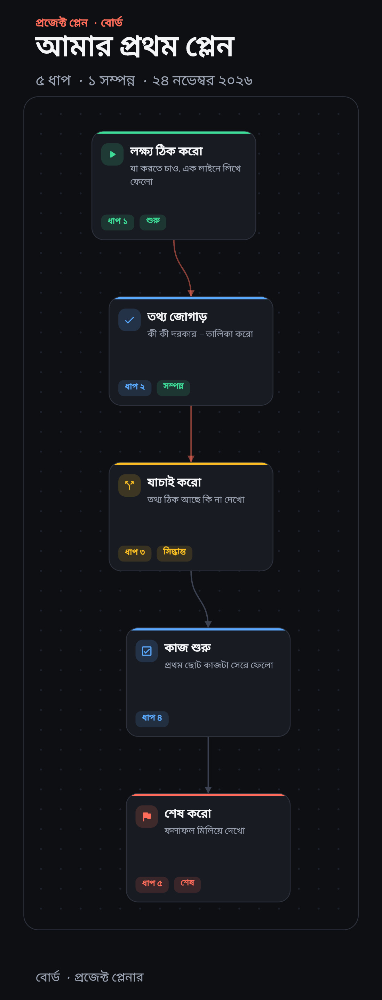

# বোর্ড (Board)

n8n-ধাঁচের ক্যানভাসে প্রজেক্ট প্লেন বানানোর অ্যাপ — ধাপে ধাপে কাজ সাজাও, নাম দিয়ে সেভ করো, JPG বা PDF ডাউনলোড করো।

## ফিচার

- **নোড ক্যানভাস** — n8n-এর মতো ডটেড গ্রিড, বেজিয়ার কানেকশন, অ্যারো হেড, ড্র্যাগেবল নোড কার্ড, পিন্চ-জুম ও প্যান।
- **হাতে লেখা বোল্ড ফন্ট** — Caveat + Atma (বাংলা) fallback চেইন, তাই বাংলা-ইংরেজি মিক্স লাইনেও একই **হাতে-লেখা বোল্ড** লুক।
- **ধাপে ধাপে মোড** — ▶ চেপে এক ধাপ করে এগোনো, বর্তমান নোড হাইলাইট, কানেকশনে চলমান ডট, "সম্পন্ন" টিক।
- **নাম দিয়ে সেভ** — সব প্লেন SharedPreferences-এ (`board.plans.v1`), অটো-সেভ + নাম বদল/কপি/ডিলিট।
- **এক্সপোর্ট** — পুরো বোর্ডের ফ্রেমড ছবি **JPG**, আর প্রিন্টযোগ্য **PDF** (A4, কার্ডের ফাঁকে পেজ ভাগ হয়)।
- **অফলাইন** — কোনো সার্ভার, লগইন বা ট্র্যাকিং নেই।

## স্ক্রিনশট



## নোড টাইপ

`শুরু` · `ধাপ` · `শর্ত` · `শেষ` — প্রতিটির আলাদা রঙ ও আইকন।

## চালাও

```bash
flutter pub get
flutter run          # ডিভাইস/এমুলেটর
flutter run -d chrome
flutter test         # ৪টি টেস্ট
flutter build apk --release
```

APK আউটপুট: `build/app/outputs/flutter-apk/app-release.apk`

## এক্সপোর্ট কীভাবে কাজ করে

`lib/export_service.dart` স্ক্রিনশট নেয় না — প্ল্যান মডেল থেকে সরাসরি `Canvas`-এ রেন্ডার করে (`_scale = 1.9`), তাই যে-সাইজের প্লেনই হোক আউটপুট ক্রিস্প ও সঠিকভাবে ফ্রেমড। JPG-তে alpha ফ্ল্যাটেন করা হয়; PDF-এ A4 পেজে ভাগ করার সময় কার্ডের ফাঁক খুঁজে কাটা হয়, যাতে কোনো ধাপ মাঝখানে না কাটে।

## স্ট্রাকচার

```
lib/
├── main.dart           # অ্যাপ এন্ট্রি, থিম
├── theme.dart          # n8n ডার্ক প্যালেট + hand() টেক্সট হেল্পার
├── models.dart         # PlanNode, BoardPlan, NodeKind, JSON, contentBounds
├── storage.dart        # SharedPreferences ভিত্তিক PlanStore
├── painters.dart       # গ্রিড, কানেকশন, অ্যাক্টিভ হ্যালো পেইন্টার
├── node_card.dart      # নোড কার্ড উইজেট
├── home_screen.dart    # প্লেন লিস্ট + ড্যাশবোর্ড
├── board_screen.dart   # ক্যানভাস, এডিটর, ধাপ-মোড, এক্সপোর্ট
└── export_service.dart # JPG/PDF রেন্ডার
```

## লাইসেন্স

MIT
